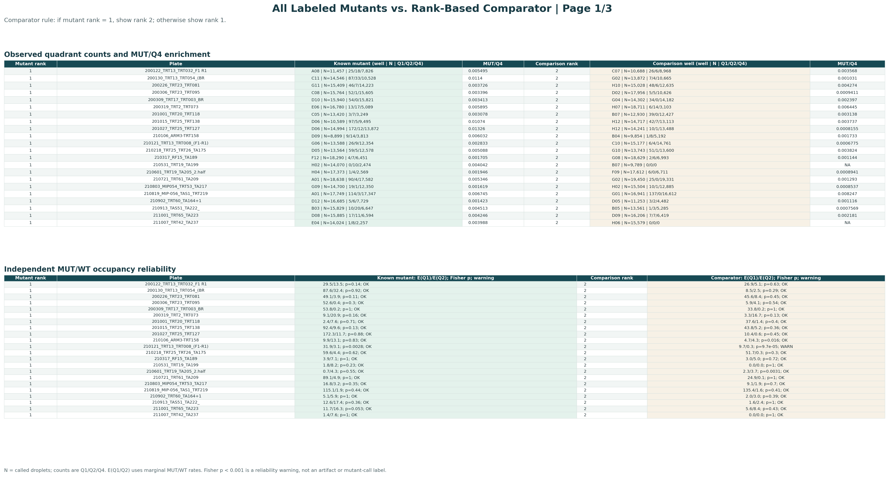
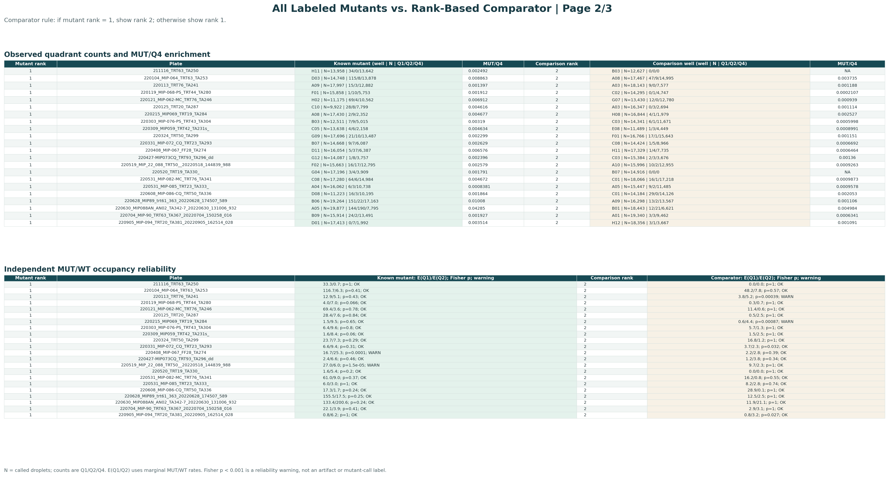

# All Labeled Mutants: Rank-Based Comparison

All 66 known mutant wells are paired with a comparator selected by rank: when the known mutant is rank 1, the comparator is rank 2; otherwise the comparator is rank 1. The combined PDF contains all three figure pages.

[Download the complete vector PDF](mut_prediction_model_output/all_labeled_mutants_comparison.pdf)

## Page 1 of 3

## Page 2 of 3

## Page 3 of 3

